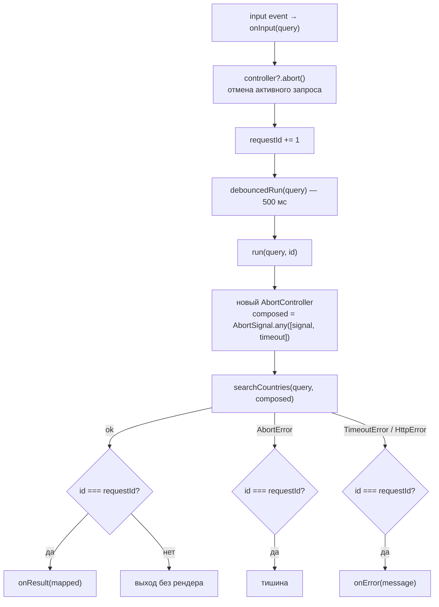

# DESIGN.md — Country Search

Живой поиск стран через `https://countries.dev`. TypeScript, `tsc` в ES-модули, Vitest, без фреймворков и сторонних библиотек для debounce.

Разделение: `src/core` — логика без DOM и сети (тестируется в окружении `node`), `src/ui` — построение интерфейса, `tests` — тесты и JSON-фикстура.

## 1. Отмена устаревших запросов

### Проблема

При быстром наборе («b» → «br» → «bra» → «braz») в сеть уходят несколько запросов, порядок ответов не гарантирован. Сервер может ответить на `bra` раньше, чем на `braz`, и на экране окажется список, не соответствующий тексту в поле.

### Почему не «флаг актуальности» и не фильтр по времени

Хранить номер последнего запроса и не рисовать ответ с несовпадающим номером — самый дешёвый способ, но он лечит симптом:

| Чего не решает фильтрация         | Последствие                                                                                             |
| --------------------------------- | ------------------------------------------------------------------------------------------------------- |
| запрос остаётся в полёте          | тратится трафик; браузер держит ~6 соединений на хост, поэтому нужный запрос ждёт в очереди за ненужным |
| таймер таймаута продолжает тикать | через 5 секунд придёт `TimeoutError` от запроса, который уже никому не нужен                            |
| отмена не видна браузеру          | в Network запрос висит как `pending`, а не `canceled`                                                   |

Задание требует реальной отмены через `AbortController`, а не фильтрации результатов постфактум.

### Решение: два уровня защиты (в `searchController.ts`)



**Первый уровень — `AbortController`.** Отмена вызывается в двух местах: в `onInput` (сразу при каждом изменении ввода) и в `delayedFn` (перед новым сетевым вызовом). Первый вызов закрывает требование «отмена при каждом изменении ввода, а не только когда debounce запускает запрос»: за 500 мс ожидания старый запрос уже неактуален. Второй — страховка для запроса, стартовавшего в том же окне debounce.

**Второй уровень — счётчик `requestId`** (`searchController.ts`). Он увеличивается в `onInput`, то есть в момент, когда решение пользователя принято, а не в момент старта запроса. Это принципиально: если увеличивать его только в `run`, между вводом и стартом проходит 500 мс debounce, в течение которых устаревший ответ всё ещё считается актуальным.

Зачем второй уровень при наличии `abort`: `abort()` **не отменяет назад** уже исполненный промис. Если `fetch` успел получить ответ до вызова `abort()`, промис перешёл в `fulfilled`, и его продолжение выполнится — отменить это нельзя. Проверка `if (id !== requestId) return` — единственная защита в этом окне; она же делает поведение инвариантным к порядку микрозадач.

Проверка стоит **до** `mapCountryResponse` и **до** колбэков: устаревшие данные не тратят время на маппинг и не попадают в DOM. Такая же проверка стоит в `catch`, иначе отмена старого запроса показала бы ошибку поверх нового.

### Таймаут и композиция сигналов

`searchCountries(query, signal)` принимает один сигнал, а причин отмены две, поэтому они сливаются:

```ts
const composed = AbortSignal.any([signal, AbortSignal.timeout(timeoutMs)]);
```

`AbortSignal.any` возвращает сигнал, который отменяется при аборте любого источника и наследует его `reason`. Именно поэтому `fetch` отклоняется разными ошибками, и ветки различимы.

### Различение ошибок

| Ошибка                              | Источник                 | Реакция                                     | Почему                                                                                                                                                    |
| ----------------------------------- | ------------------------ | ------------------------------------------- | --------------------------------------------------------------------------------------------------------------------------------------------------------- |
| `404`                               | `searchCountries`        | `return []` — **до** проверки `response.ok` | «совпадений нет» — пустой результат, а не ошибка. `response.ok` для 404 тоже `false`, поэтому порядок проверок критичен: иначе 404 стал бы экраном ошибки |
| `HttpError`                         | `searchCountries`        | `onError` со статусом                       | `fetch` не бросает на 4xx/5xx, статус проверяется руками                                                                                                  |
| `AbortError`                        | `abort()`                | `return`, без колбэков                      | отмена своего же запроса не показывается пользователю                                                                                                     |
| `TimeoutError`                      | `AbortSignal.timeout`    | `onError`                                   | отсутствие ответа — настоящая ошибка                                                                                                                      |
| `TypeError`, `SyntaxError` и прочее | сеть, прокси, битый JSON | `throw error`                               | не маскируем: неизвестная ошибка — баг, её нужно видеть в консоли                                                                                         |

`abort()` вызывается **без аргумента**. Если передать строку или свой `Error`, `fetch` отклонится именно этим значением, условие `error.name === 'AbortError'` перестанет выполняться, и пользователь увидит ошибку при обычном наборе текста.

### Ограничения

Один активный запрос на контроллер: новый ввод гасит предыдущий. Для одной поисковой строки верно, но не подошло бы для параллельных запросов, где нужен отдельный `AbortController` на каждую задачу. Проверка `requestId` не отменяет сетевой запрос — она дополняет `abort`, а не заменяет его.

## 2. Задержка debounce — 500 мс

`debounce(fn, delay)` (`src/core/debounce.ts`) сбрасывает предыдущий таймер при каждом вызове, поэтому `fn` исполняется только после паузы `delay` мс. Один запрос на «порцию» набора, а не на каждую букву.

### Почему 500 мс

Ориентир — темп набора и порог восприятия задержки. 500 мс примерно соответствует паузе между словами: средняя скорость набора 150–250 мс на символ, между словами человек замирает на 300–600 мс. Это точка, где debounce уже перестаёт «дёргать» и ещё не ощущается как лаг.

| Задержка           | Эффект                                                                                                                                                                             |
| ------------------ | ---------------------------------------------------------------------------------------------------------------------------------------------------------------------------------- |
| `0` (без debounce) | запрос на каждую букву: «brazil» — 6 запросов, 5 отменяются. Браузер держит ~6 соединений на хост, поэтому нужный запрос встаёт в очередь за мусором, в Network — стена `canceled` |
| `150–200` мс       | заметно больше запросов, чем нужно: пауза «подумать» перед следующей буквой уже считается концом ввода                                                                             |
| `500` мс           | один запрос на слово; спиннер появляется сразу при вводе, поэтому пауза не читается как зависание                                                                                  |
| `1000–1500` мс     | ощутимая задержка: поиск «залипает», пользователь начинает дописывать буквы, не дождавшись результата, и снова сбрасывает таймер — приложение выглядит сломанным                   |
| `> 2000` мс        | поиск фактически по кнопке "Поиск"; debounce теряет смысл                                                                                                                          |

### Что будет при отказе от debounce

Формально приложение останется корректным: `abort` + `requestId` гарантируют, что на экране только последний ответ. Но возрастает нагрузка на сервер, запросы конкурируют за лимит соединений (последний ответ приходит позже, чем при debounce), а в Network вместо одного запроса висят десятки `canceled`.

## 3. Сложность `mapCountryResponse`

`mapCountryResponse` (`src/core/mapCountryResponse.ts`) — чистая функция «сырой JSON → доменная модель», без сети и DOM.

### Разбор по операциям

| Операция                                                 | Сложность                     |
| -------------------------------------------------------- | ----------------------------- |
| чтение скалярных полей с fallback (`??`, тернарники)     | O(1), число полей фиксировано |
| `raw.latlng.length === 2` и создание `{ lat, lng }`      | O(1)                          |
| `raw.languages.map(...)`                                 | O(L), L — число языков        |
| `raw.currencies.map(...)`                                | O(C), C — число валют         |
| `[...(raw.borders ?? [])]`, `[...(raw.timezones ?? [])]` | O(B), O(T)                    |

Итог: `O(1 + L + C + B + T) = O(k)`, где `k` — суммарное число вложенных элементов. На практике `L ≤ 3`, `C ≤ 2`, `B ≤ 15`, `T ≤ 12`, то есть `k` ограничено датасетом и не зависит от запроса — с точки зрения роста функция ведёт себя как **O(1)**. Квадратичных участков нет: циклов по странам, сортировок и вложенных проходов по одному массиву внутри другого в функции отсутствуют.

### Кэш и дедупликация (бонус не реализован)

Кэша в проекте нет — бонусное задание не выполнялось. Оценки, если бы оно делалось:

## 4. Принципы чистого кода и где они применены

| Принцип                                | Где                                    | Как проявляется                                                                                                                                                                                                                                                                     |
| -------------------------------------- | -------------------------------------- | ----------------------------------------------------------------------------------------------------------------------------------------------------------------------------------------------------------------------------------------------------------------------------------- |
| **SRP** — единственная ответственность | каждый модуль `core` и `ui`            | `debounce.ts` — только задержка; `searchCountries.ts` — только HTTP запрос; `mapCountryResponse.ts` — только преобразование; `searchController.ts` — только оркестрация; `renderCard.ts` / `openDetails.ts` — только отрисовка. UI не знает про сеть, сетевой слой не знает про DOM |
| **Чистые функции**                     | `debounce.ts`, `mapCountryResponse.ts` | нет обращений к `fetch`, `document`, `Date.now()`. По входу предсказуем выход — отсюда тесты без браузера и без сети, на JSON-фикстуре                                                                                                                                              |
| **Отделение модели от границы**        | `types.ts`                             | `RawCountry` — «что приходит» (обязателен только `name`), `Country` — «с чем работает приложение» (обязательные поля, `readonly`). `undefined` не выходит за пределы маппера                                                                                                        |
| **DRY на уровне правил, а не строк**   | `mapCountryResponse.ts`                | нормализация языков и валют — одинаковый паттерн «map + `?? ''`» дважды, но данные разные; вынос в одну функцию с флагом типа ухудшил бы читаемость. Общими сделаны правила: `svg → png → ''`, `latlng → Coordinates \| null`, `?? []` для массивов                                 |
| **Инверсия управления**                | `searchController.ts`                  | контроллер не знает, кто рисует: `onResult`/`onError` передаются снаружи. Поэтому логика тестируется без DOM, а UI может быть любым                                                                                                                                                 |
| **Исчерпывающий разбор состояний**     | `searchScreen.ts`                      | `ResultState` — размеченное объединение из пяти вариантов, `switch` без `default`: при добавлении шестого состояния `noImplicitReturns` заставит дописать ветку. «Забыть» отрисовать состояние невозможно                                                                           |
| **Единая точка изменения DOM**         | `searchScreen.ts`                      | `results.replaceChildren(...)` в каждом обработчике: экран всегда соответствует одному состоянию, а не накоплению манипуляций «покажи тут, спрячь там»                                                                                                                              |
| **Безопасность по умолчанию**          | `element.ts`                           | только `textContent` и `append`, ни одного `innerHTML`. Данные из внешнего API не могут стать разметкой — XSS через название страны невозможен                                                                                                                                      |
| **Fail fast**                          | `searchController.ts`                  | неизвестная ошибка пробрасывается, а не превращается в пустой экран: пользователь не увидит «ничего не найдено», если на самом деле нет сети                                                                                                                                        |
| **Константы вместо магии**             | `constants.ts`, `searchController.ts`  | `FLAG_PLACEHOLDER` вынесен, чтобы путь не дублировался в `renderCard.ts` и `openDetails.ts`; `timeoutMs` — параметр с значением по умолчанию                                                                                                                                        |

Граница ответственности проверяется тем, что все тесты `core` запускаются в окружении `node`, где `document` отсутствует: если бы зависимость от DOM появилась, тесты упали бы.
